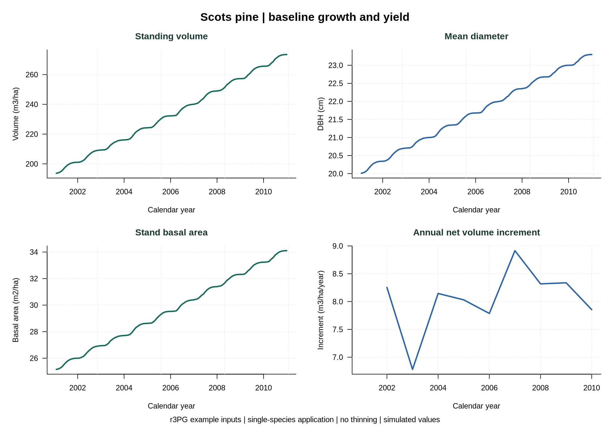
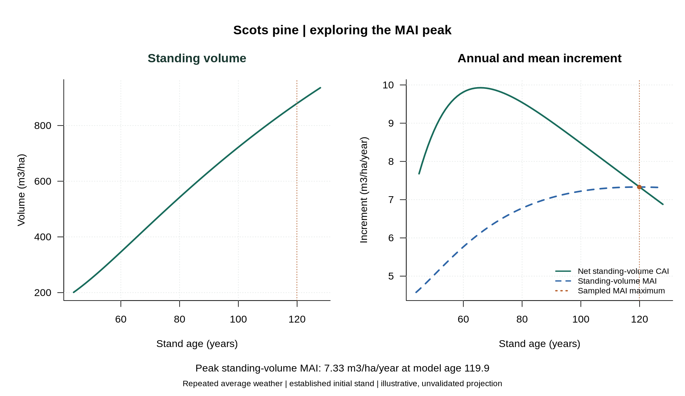
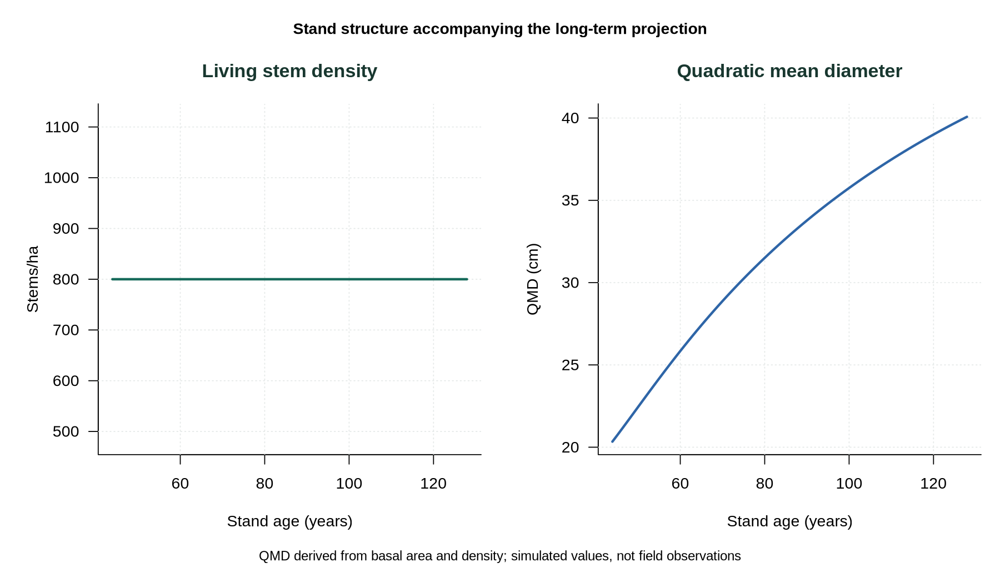

# Forest growth and yield with r3PG

**Scots pine stand development, annual yield tables, and interpretation of CAI and MAI in R.**
We applied the existing 3-PG process-based model through `r3PG` to Scots pine (*Pinus sylvestris*). It contains two reproducible analyses: a baseline simulation using the package's weather sequence and a longer simulation exploring the maximum of standing-volume-based mean annual increment.

The focus is translating monthly model output into useful stand metrics and checking what those metrics support. All inputs come from package examples (packages:r3pg); no independent inventory observations are used.

## Questions

1. How do predicted standing volume, mean diameter, and basal area develop during 2001-2010?
2. Under repeated average weather, when does standing-volume-based MAI reach its maximum within 2001-2085?
3. Do annual CAI-MAI crossings and stand-structure outputs support the interpretation of that maximum?

## Results

| Result | Included run |
|---|---:|
| Baseline December 2001 standing volume | 201.05 m3/ha |
| Baseline December 2010 standing volume | 273.47 m3/ha |
| Baseline 2010 net volume increment | 7.85 m3/ha/year |
| Long-term maximum standing-volume MAI | 7.33 m3/ha/year |
| Model stand age at that maximum | 119.92 years |
| Calendar year of that maximum | 2077 |
| Downward CAI-MAI crossing interval | December 2077-December 2078 |

These are simulated values from r3PG 0.1.6, not estimates of observed Scots pine productivity. The long-term MAI maximum is an interior maximum of the annual samples, not an operational harvest recommendation.

**Interpretation:** the annual net increment eventually falls below standing-volume MAI. The sampled MAI maximum and the crossing interval are close but not identical because CAI is a preceding-year change assigned to the year's endpoint, whereas MAI is an endpoint stock-to-age ratio.

## Methods and assumptions

| Component | Choice |
|---|---|
| Initial stand | Pine row of `d_species`; 800 stems/ha; planting date 1958-01 |
| Initial biomass | 90 Mg/ha stem, 15.2 Mg/ha root, 3 Mg/ha foliage |
| Site | Package `d_site`; simulation starts 2001-01 at model age 43 |
| Baseline weather | Package `d_climate`, subset by r3PG to 2001-2010 |
| Long-term weather | Calendar-month means of the full example weather table, repeated for 2001-2085 |
| Species parameters | Pine columns from `d_parameters` and `d_sizeDist` |
| Model settings | Light, transpiration and physiology option 2; height option 1; bias correction and isotopes off |
| Management | No thinning |

The original example contains pine and beech. Extracting pine changes the stand composition, so this is a single-species application, not reproduction of the original mixed-stand example. Initial stocks are retained, rather than relabeled as seedlings. The model clamps initial available soil water from the example's 999 mm to the site's 106 mm maximum.

The repeated climate also repeats monthly mean CO2. It is a controlled average-weather scenario, not future climate or CO2 projection. It removes interannual weather variability and does not represent drought, disturbance, or management histories. Size-distribution inputs are supplied, but size-distribution bias correction is disabled.

## Calculations

December stocks are extracted from monthly predictions. Monthly standing volumes are **not summed** to obtain annual yield.

| Quantity | Calculation | Units |
|---|---|---|
| Net standing-volume CAI | December volume minus previous December volume | m3/ha/year |
| Standing-volume MAI | December standing volume divided by model stand age | m3/ha/year |
| Quadratic mean diameter | `sqrt(40000 * basal_area / (pi * stems_n))` | cm |

The first annual increment is missing because the previous December is outside the simulation. QMD is the diameter corresponding to average tree basal area, not generally the arithmetic mean diameter. No merchantable-volume or product-assortment system is added.

For a smooth yield curve `V(t)`, the derivative of `V(t)/t` is `[t V'(t) - V(t)] / t^2`; its interior stationary point occurs where instantaneous increment equals mean increment. Annual finite differences approximate that relationship. A crossing alone does not establish a global optimum.

## Stand structure and model limitations

Stem density remains at 800 stems/ha throughout the long-term run. At the sampled MAI peak, predicted basal area is approximately **95.50 m2/ha**. This high stocking output warrants review of mortality, self-thinning, allometry, site conditions, and parameter applicability before practical use. The smooth yield curve alone is insufficient evidence of realistic stand development.

This project does not reconstruct the stand's pre-2001 removals or mortality. Consequently, standing volume divided by age is not a reconstruction of total-production MAI. There is no calibration, independent validation, forecast interval, or financial rotation analysis. The results do not demonstrate that a 120-year rotation is appropriate for a real stand.

## Verification and next step

Both analyses were executed. Runtime checks require complete monthly coverage, consecutive annual endpoints, unique output dates, finite/nonnegative stocks, and positive age and density. Arithmetic checks confirm a known positive/negative volume increment sequence and the QMD formula. These checks verify calculations and data handling; they do not measure ecological accuracy.

The next research step is evaluation against independent repeated inventory plots with compatible volume definitions. See the [validation plan](docs/validation_plan.md). This application demonstrates model input handling, annual aggregation, biometric calculations, visualization, and critical interpretation. It does not yet demonstrate fitting or validating an empirical growth model.

## References and attribution

- Trotsiuk, V., Hartig, F., Forrester, D., & Silveyra Gonzalez, R. (2023). *r3PG: Simulating Forest Growth using the 3-PG Model*. R package 0.1.6. [CRAN](https://CRAN.R-project.org/package=r3PG) | [Source](https://github.com/trotsiuk/r3PG).
- Landsberg, J. J., & Waring, R. H. (1997). A generalised model of forest productivity using simplified concepts of radiation-use efficiency, carbon balance and partitioning. *Forest Ecology and Management*, 95, 209-228. [DOI](https://doi.org/10.1016/S0378-1127(97)00026-1).
- Forrester, D. I., & Tang, X. (2016). Analysing the spatial and temporal dynamics of species interactions in mixed-species forests and the effects of stand density using the 3-PG model. *Ecological Modelling*, 319, 233-254. [DOI](https://doi.org/10.1016/j.ecolmodel.2015.07.010).

The 3-PG model and r3PG implementation are credited to their authors. This repository provides application scripts and interpretation using their example inputs. Used AI assistance to make script more reproducible and readable.
